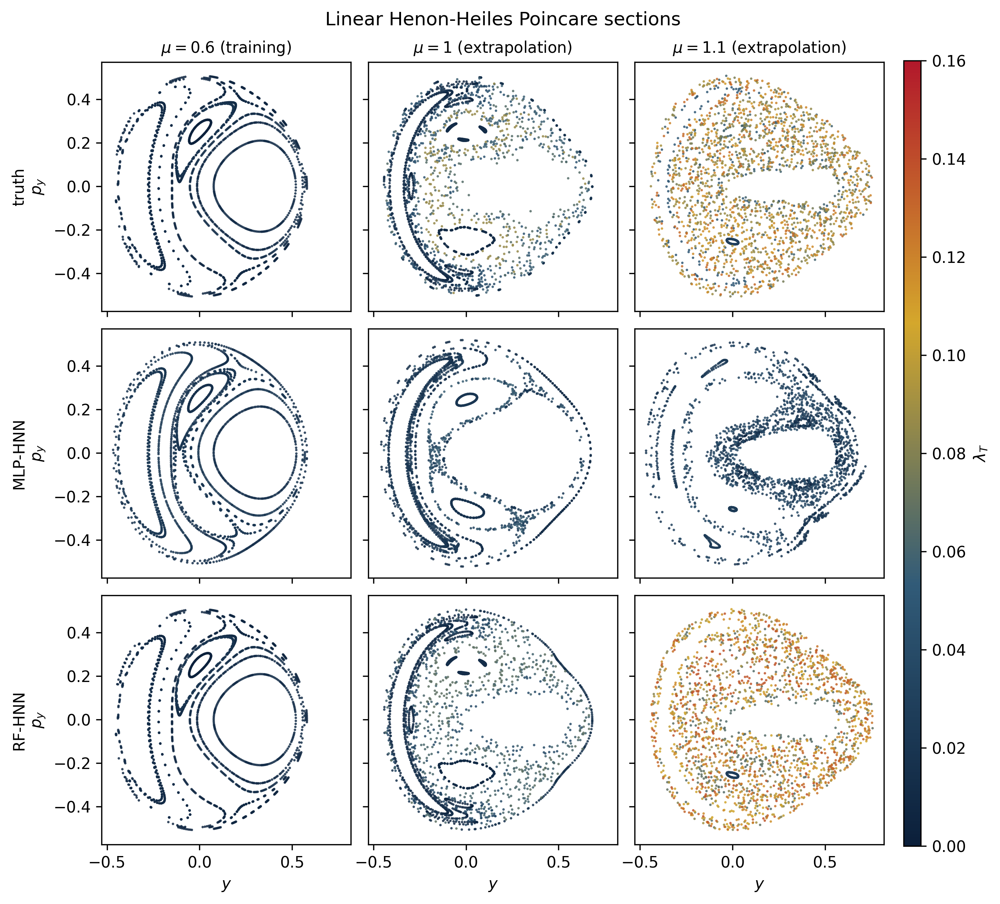

# rf-hnn-chaos

Code companion for random-feature Hamiltonian neural networks (RF-HNNs)
extrapolating from predominantly regular training regimes to unseen chaotic
regimes.

This repository covers the four two-degree-of-freedom Hamiltonian families of
the associated manuscript: the canonical Henon-Heiles system, a bounded
mu-squared variant, a confined Barbanis-type system, and a bilinearly coupled
Morse pair. It also contains the backpropagated MLP-HNN baseline used for
comparison, with its training code and the trained weights
(`models/mlp_<family>.npz`, 20 members per family).

The figure compares the true, MLP-HNN, and RF-HNN Poincare sections of the
linear family.



## Run

```bash
pip install -r requirements.txt
python reproduce.py --check
```

The command uses the included hyperparameters, MLP-HNN weights, and cached
evaluations, refits the RF-HNN readouts, writes the three figures to
`figures/`, and prints the RF-HNN vs MLP-HNN comparison at the extrapolation
controls of the four families. The printed values can differ slightly from
Table II of the manuscript because of floating-point rounding.

To repeat hyperparameter selection from scratch:

```bash
python reproduce.py --search --trials 100
```

To retrain the MLP-HNN baseline (needs torch):

```bash
python reproduce.py --train-mlp
```

Both take substantially longer. No external dataset is required; all
training, validation, and evaluation arrays are generated deterministically.
Extrapolation data is not used for fitting or model selection.

## License

MIT (see `LICENSE`).
